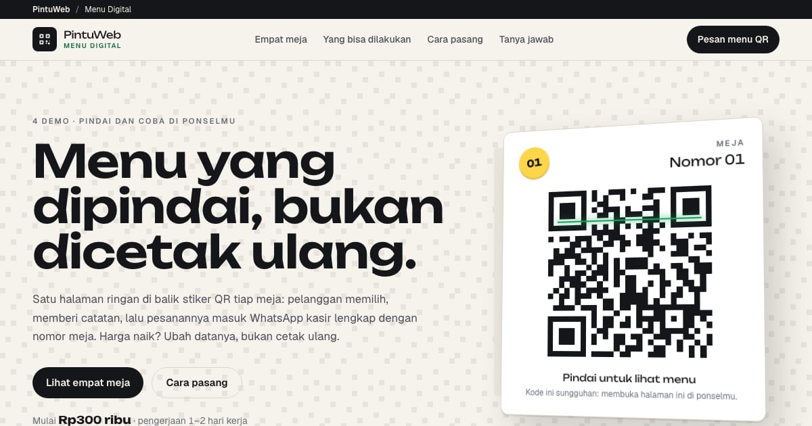

# PortalMenu — Empat Meja, Empat Warung

Galeri demo menu digital (QR menu) PintuWeb: kedai kopi, warung bakso, warung makan Jepang, dan dessert bar. Tiap kartu menautkan ke demo live yang bisa dicoba dari nomor meja contohnya.

**Demo live:** https://www.pintuweb.id/menu-digital



> Katalog demo milik PintuWeb. Semua usaha di demo fiktif.

## Konsep

Kartu tenda (tent card) di atas meja: hero memuat QR sungguhan yang membuka halaman ini di ponsel, stiker nomor meja kuning menandai tiap demo, dan langkah pemasangan ditulis seperti struk kasir. Tekstur latar memakai pola modul QR tipis.

## Varian yang dipamerkan (4)

- [Sepertiga Kopi](https://menu-kopi.pintuweb.id) — daftar berpenuntun titik, kartu cupping
- [Bakso Dalu](https://menu-bakso.pintuweb.id) — ubin bergambar mangkuk, level pedas
- [Akagane Shokudō](https://menu-jepang.pintuweb.id) — nampan lacquer, teishoku, ikon alergen
- [Lintang Manis](https://menu-dessert.pintuweb.id) — bento pastel, rakit bowl

Tangkapan layar ponsel tiap demo ada di `public/images/menu/<slug>.webp` (390×844); varian WebP-nya dibuat `node scripts/static-images.mjs . --base /menu-digital`.

## Halaman

`/` (tayang sebagai `/menu-digital` di domain utama lewat basePath + rewrite PintuWeb) dan 404 bergaya.

## Teknologi

- Next.js 15.5 (App Router) dan React 19, JavaScript
- Tailwind CSS v4
- Font: Unbounded, Geist (next/font)
- QR SVG dibuat saat build dengan `qrcode`
- SEO: metadata, Open Graph, JSON-LD CollectionPage + ItemList + BreadcrumbList + FAQPage

Angka paket diambil dari `app/components/pintuweb.js` (PAKET: paket Landing Page di PintuWeb/app/lib/packages.ts).

## Menjalankan secara lokal

```bash
npm install
npm run dev
```

Buka http://localhost:3000/menu-digital. Untuk build produksi: `npm run build` lalu `npm start`.

---

Dibuat oleh [PintuWeb](https://www.pintuweb.id), jasa pembuatan website.
